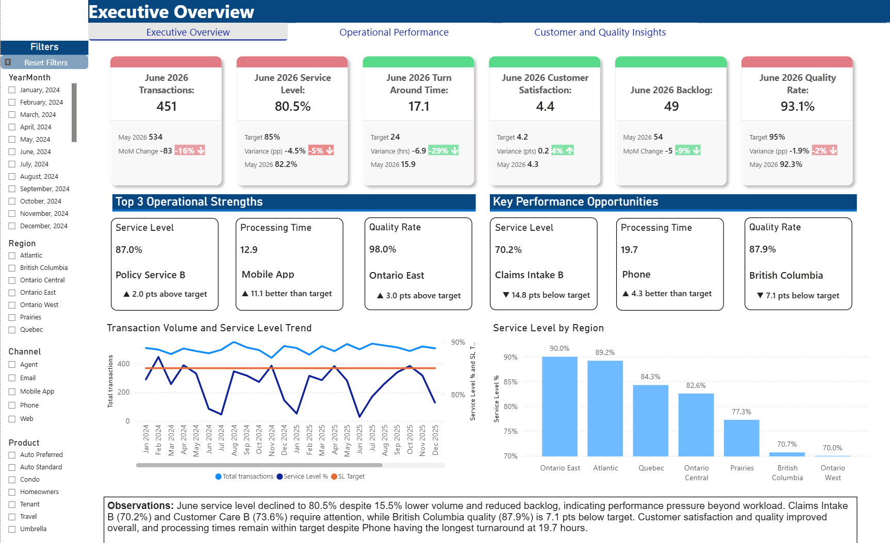
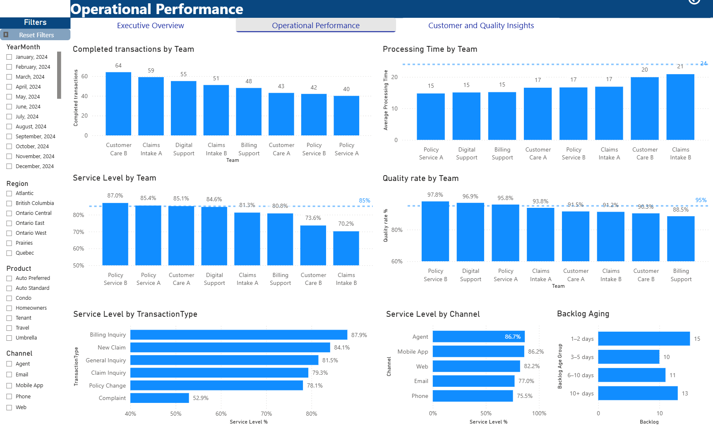
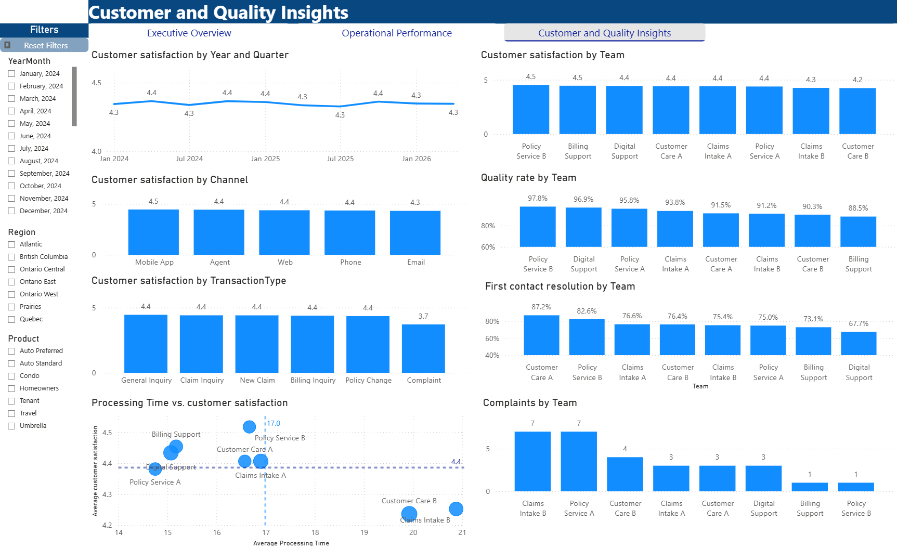
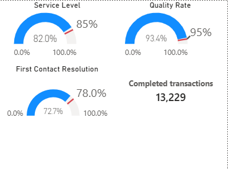
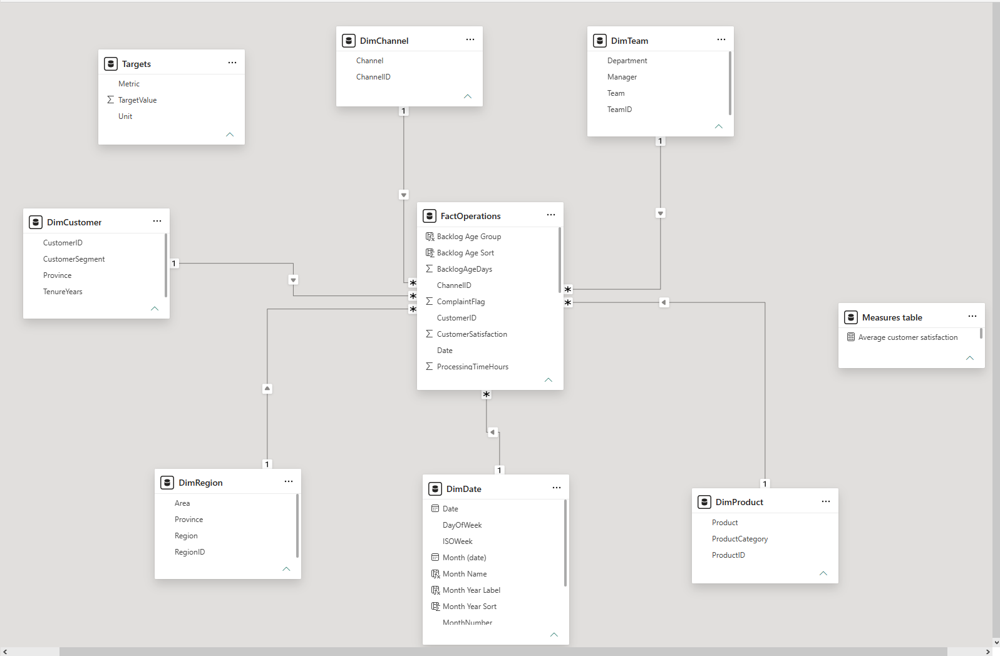

# Insurance Operations Performance

**Author:** Laurent Holleville  
**Tools:** Power BI Desktop, DAX  
**Data:** Synthetic insurance operations data; this project does not represent an employer's results.

## Business purpose

This report helps insurance operations leaders monitor service delivery, identify performance gaps and decide where to investigate. It connects executive KPIs with team, region, channel and transaction-type analysis, while considering quality and customer experience alongside speed and volume.

## Report pages

### Executive Overview

Latest-month cards show transaction volume, service level, processing time, customer satisfaction, backlog and quality. Previous-month comparisons and targets provide context. Strengths and opportunities highlight segments to investigate; charts show volume/service trends and regional differences.

### Operational Performance

Team comparisons cover completed transactions, processing time, service level and quality. Additional views break down service levels by transaction type and channel and show backlog aging.

### Customer and Quality Insights

Customer satisfaction is analysed over time and by team, channel and transaction type. Quality, first contact resolution and complaint counts add context. A scatter chart supports exploration of processing time and satisfaction; it does not establish causation.

### Team tooltip

A supporting tooltip page includes gauges for service level, quality and first contact resolution, plus completed transactions. Its values depend on the context passed by the source visual; the supplied standalone screenshot does not identify a selected team.

## KPI targets displayed in the report

| KPI | Target | Desired direction |
|---|---:|---|
| Service level | 85% | Higher |
| Average processing time | 24 hours | Lower |
| Customer satisfaction | 4.2 out of 5 | Higher |
| Quality rate | 95% | Higher |
| First contact resolution | 78% | Higher |

Transaction volume and backlog are presented with previous-month comparisons rather than fixed targets. Lower volume requires business context before being classified as favourable or unfavourable.

## Model and measures

The PBIX diagram identifies FactOperations, DimDate, DimTeam, DimRegion, DimChannel, DimProduct, DimCustomer, Targets and a dedicated Measures table. Report visuals reference reusable measures for KPIs, targets, prior-month comparisons and best/worst segment summaries.

The supplied Model view shows six dimension tables with one-to-many, single-direction relationships into FactOperations. Targets is disconnected, and the Measures table organizes reusable calculations.

Core measures are documented in `DAX_Measures.md`. Total transactions counts rows; completed transactions filters Status to Completed. Service level counts all transactions with recorded processing time at or below 24 hours, including outstanding cases. The author confirms that outstanding cases have populated processing times. Quality counts QualityPassed = 1 over all transactions. Average processing time averages recorded values across all statuses. Backlog counts rows with BacklogAgeDays > 0 within the active filter context; it does not reconstruct historical open-case inventory from receipt and closure dates.

Previous-month measures shift the active date selection back one month. The previous-month label uses the maximum date in context. Use a single-month context when interpreting these as individual monthly comparisons. Source transformations and the meaning of processing time for outstanding cases are not established by the supplied documentation.

## Example findings from the supplied screenshots

These are descriptive findings from synthetic data. The latest-month cards and other visuals may use different date contexts; they should not be treated as one common-period analysis and are described within their displayed contexts. The executive cards display June 2026 while the trend chart displays a longer historical period.

- June 2026 service level is 80.5%, **4.5 percentage points below** the 85% target. It fell from 82.2% in May, while transactions declined from 534 to 451 and backlog fell from 54 to 49. Investigate staffing, work mix and process performance before attributing the change to a cause.
- June quality is 93.1%, **1.9 percentage points below** target, despite improving from 92.3% in May. Average processing time is 17.1 hours, within the 24-hour target, and satisfaction is 4.4 against a 4.2 target.
- The operational screenshot shows complaint transactions at 52.9% service level; the customer page shows satisfaction of 3.7 for complaint transactions. Review the complaint journey and resolution process, accounting for sample size and case complexity.
- The operational screenshot shows 13 of 49 backlog cases in the 10+ day bucket, approximately **26.5%**. Review aged cases and escalation needs.
- Billing Support has 88.5% quality in the team view, while Claims Intake B has 70.2% service level. These suggest different investigation priorities rather than a single intervention for every team.

## Skills demonstrated

KPI design, reusable measures, time comparisons, target-based formatting, dimensional analysis, page navigation, slicers, report-page tooltip design, backlog aging and business interpretation.

## Files and use

- `Operational_Report.pbix`: Power BI Desktop report.
- `screenshots/`: supplied page images.
- `Portfolio_Review_and_Demo.md`: presentation notes, a short demo script and project wording.
- `DAX_Measures.md`: supplied core formulas and definitions.
- `GitHub_Setup.md`: upload steps and suggested repository description.

Open the PBIX in Power BI Desktop to explore the report. Screenshots provide a static preview. Refresh may require access to the original source files; no separate source dataset is included in this package.

## Validation status

The author confirms that May and June KPI values have been QA checked in Power BI Desktop. This documentation review uses the updated screenshots, Model view, supplied DAX and report files. The month-year axis and unit-specific variance labels are visible in the latest executive screenshot. This review did not independently execute DAX or test refresh, filter synchronization, tooltip interaction or drill-through. Date-table marking and behaviour with no month or multiple months selected were not separately confirmed. No real-world performance improvements are claimed for this portfolio project.
